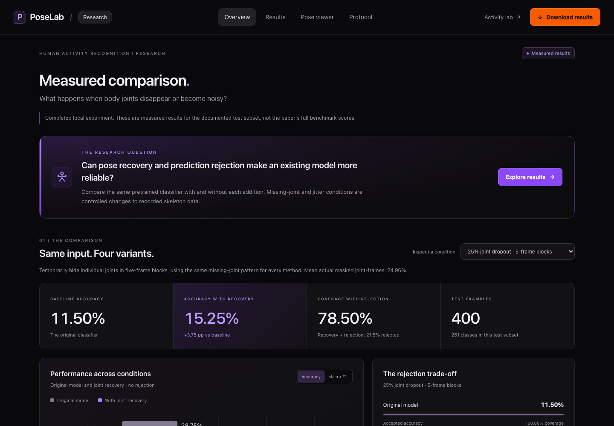

# PoseLab

**Human Activity Recognition using Pose Estimation**  
Mini Project II · Indian Institute of Information Technology Dharwad · Aug–Nov 2026

**Team roll numbers:** 23bcs019, 23bcs007, 23bcs021

**Mentor:** SUNIL CK

The primary project is now **Robust Human Activity Recognition using Pose Estimation and Missing-Joint Recovery**, an experimental extension of **Continual Spatio-Temporal Graph Convolutional Networks**, *Pattern Recognition* 140 (2023), 109528, by Hedegaard, Heidari and Iosifidis. [Published paper](https://doi.org/10.1016/j.patcog.2023.109528) · [Official implementation](https://github.com/LukasHedegaard/continual-skeletons) · [Q1 journal evidence: SCImago/SJR 2024](https://www.scimagojr.com/journalvalue.php?area=1700&category=1707&ord=desc&order=item).

We reuse the authors' 400-class Kinetics checkpoint and original graph-network definitions. Our extension adds bounded causal recovery of missing pose joints, a conservative person-slot reset, and calibration-based rejection. The comparison uses **600 real public Kinetics-skeleton clips: 200 for calibration and 400 for extension evaluation**, with identical controlled corruptions for every variant. This is a pilot using the dataset's official validation partition, not a reproduction of the full paper's benchmark or a new state-of-the-art claim.

**Open the research dashboard:** start `python run.py` and visit **http://127.0.0.1:8765/**. Saved measured results can be viewed without downloading the research model or dataset.

- [Measured results and limitations](docs/RESEARCH_RESULTS.md)
- [Standalone results report](results/research/report.html) · [PDF report](output/pdf/PoseLab_Research_Results.pdf)
- [Research presentation](deliverables/PoseLab_Research_Presentation.pptx)
- [Research explanation and viva preparation](docs/RESEARCH_VIVA.md)
- [Per-clip predictions](results/research/predictions.csv), [measured JSON](results/research/comparison.json), [sample provenance](results/research/data-manifest.json)
- [Reproducible Colab notebook](notebooks/Research_Comparison.ipynb) · [Open in Colab](https://colab.research.google.com/github/4uashish2628/miniproject-2/blob/main/notebooks/Research_Comparison.ipynb)

### Measured results

All-input accuracy on the same **400 test clips**, with all 400 classifier outputs retained. Repair settings were chosen using 200 different calibration clips. These are our measured pilot scores, not the paper's published full-dataset scores.

| Condition | Original model | With our recovery | Difference |
| --- | ---: | ---: | ---: |
| Original poses | 28.75% | 29.00% | +0.25 pp |
| Short joint gaps (25%, 5 frames) | 11.50% | 15.25% | +3.75 pp |
| Short limb gaps (25%, 5 frames) | 15.25% | 18.50% | +3.25 pp |
| Long joint gaps (25%, 15 frames) | 14.75% | 15.00% | +0.25 pp |
| Coordinate noise (std. 0.02) | 10.25% | 11.75% | +1.50 pp |

The paired 95% intervals for short joint and limb gaps are **+1.50 to +6.25 pp** and **+0.75 to +5.75 pp**. The other intervals include zero. Recovery adds processing cost (about 13 ms per 300-frame clip in the short-gap tests); this is not a streaming FPS measurement. Controlled masking of real poses does not establish robustness to physical occlusion in a new webcam scene. All regressions, rejection coverage and per-clip predictions are retained in the report.



### Reproduce the paper-based experiment

Use Python 3.12. From this project directory, with a virtual environment active:

```sh
python -m pip install -r requirements-research.txt
python scripts/setup_research.py
python scripts/research_data.py
python -m research.benchmark --phase all
python scripts/render_research_report.py
python run.py
```

The setup clones the exact upstream commit into `.build/continual-skeletons` and verifies the authors' checkpoint hash. The data downloader retrieves only the chosen archive members (about 52 MB transfer, about 98 MB raw selected JSON in this pilot), rather than the complete 7.47 GB archive. CPU, Mac GPU and CUDA are supported by the runner; Colab GPU availability depends on the session. Use `--device cpu` when necessary. Results are overwritten by an explicit rerun; copy `results/research` first if retaining multiple runs.

The published protocol uses the default 200 calibration / 400 test clips; keep these counts when reproducing this report. For calibration and evaluation as separate steps, keep the same device and batch size:

```sh
python -m research.benchmark --phase calibrate --device cpu --batch-size 2
python -m research.benchmark --phase evaluate --device cpu --batch-size 2
```

The runner freezes configuration and implementation hashes before evaluation and checks that calibration/test IDs are disjoint. The inference adapter preserves the authors' model method bodies while bypassing their legacy training framework. It checks clip/continual execution equivalence numerically. Downloaded upstream source, weights and raw data stay outside the published source tree; fetch them with the provided scripts.

### Earlier six-activity prototype

The original MediaPipe/Random Forest activity lab remains available at **http://127.0.0.1:8765/lab**. It is a separate prototype: its webcam predictions do not use the new CoST-GCN experiment, and its simulated demos are not research results. The old [report draft](deliverables/PoseLab_Project_Report_Draft.docx), [slides](deliverables/PoseLab_Presentation_Draft.pptx), and [viva guide](docs/VIVA_AND_DEMO.md) describe that earlier version and are superseded by the research notes linked above. New webcam integration and real physical-occlusion validation remain future work.

To get the project from GitHub:

```sh
git clone https://github.com/4uashish2628/miniproject-2.git
cd miniproject-2
```

Then follow the fresh-installation instructions for your operating system below.

## Earlier prototype: setup and use

The software, simulated demo, collection tool, training/evaluation pipeline, report draft, slides and viva guide are included. **A trained classifier on real participants and real-world accuracy results are not included yet.** Collect your recordings and run the experiment to obtain them. The rule baseline works immediately. Simulated skeletons only demonstrate software behavior.

On this Mac, dependencies and pose assets are already installed:

```sh
cd /Users/ashishsingh/Desktop/miniproject
.venv/bin/python run.py
```

Open **http://127.0.0.1:8765/lab** in Chrome or Edge. If the server is already running, just open the link. To use another port: `python run.py --port 8766`.

### Fresh installation on Windows

Install Python **3.12** and Chrome or Edge. In PowerShell inside the project folder:

```powershell
py -3.12 -m venv .venv
.\.venv\Scripts\python.exe -m pip install -r requirements.txt
.\.venv\Scripts\python.exe scripts/setup_assets.py
.\.venv\Scripts\python.exe run.py
```

### Fresh installation on macOS or Linux

```sh
python3.12 -m venv .venv
.venv/bin/python -m pip install -r requirements.txt
.venv/bin/python scripts/setup_assets.py
.venv/bin/python run.py
```

No GPU, API key, paid service or Node installation is needed to run the app. Initial installation needs internet. The pose runtime/model are stored locally, so subsequent camera inference is offline. Node 20+ is only needed for the optional JavaScript tests. Do not open `index.html` directly; run the Python server.

## First demonstration

1. Open **Live lab**, choose **Squats** beside **Try simulation**, then click the button.
2. Wait about three seconds for the motion window and repeated predictions to confirm the label.
3. Observe the skeleton, knee angles and repetition count. The simulation badge remains visible.
4. Click **Stop**, then **Start camera**, and allow camera access when you choose to use it.
5. Step back until wrists and ankles fit in the image. Face front or slightly diagonally. Keep a fixed camera.
6. Use **Open video** for a compatible local MP4. The video stays in the browser.

The rule baseline is a working heuristic demonstration and can make mistakes. Select **Trained temporal classifier** only after collecting and training with real recordings.

## Finish the empirical part

Follow [the experiment protocol](docs/EXPERIMENT_PROTOCOL.md).

- Recommended pilot: **6 participants × 6 activities × 5 eight-second clips = 180 clips**. This is a plan, not an existing dataset.
- Assign participants P01–P04 to training, P05 to validation and P06 to testing before final collection. Use the same ID across all sessions for a person.
- In Live lab, choose a participant ID and performed activity. Confirm permission, then click **Record clip**. A three-second countdown precedes the eight-second recording.
- Repeat for all six activities and participants. Use the Dataset tab to check the counts.
- In Experiment, enter P05 for validation and P06 for testing. Click **Run experiment**.
- Results include raw and confidence-thresholded predictions for two feature sets, a confusion matrix, per-class metrics, feature importances, split IDs and a clip hash manifest.
- Results are saved in `results/runs/<run_id>/metrics.json` and `test_predictions.csv`. The active classifier is in `models/activity.joblib`.
- Use the real results to complete the results section of the report and slides. Preserve poor results and discuss their causes.

Three participants is the minimum accepted by the software, with one participant per split. It is a feasibility pilot with weak evidence of generalization. More participants and a larger fixed test group are preferable if time permits. A large window count does not compensate for a tiny number of independent people.

## Research question and contribution

**Does adding motion statistics improve recognition over mean pose features on unseen participants?**

The base detector follows [BlazePose](https://arxiv.org/abs/2006.10204). The use of landmark sequences for exercise classification is motivated by [Arrowsmith et al.](https://doi.org/10.3390/s23010363). We use a smaller activity set and a Random Forest for an accessible student project; we do not reproduce that paper's CNN experiment or claim its reported results.

Project-specific implementation:

- Aspect-corrected geometry and torso normalization.
- 18 pose features and 72 temporal features over two seconds.
- Quality rejection, participant-separated comparison and transparent result export.
- Three-prediction label confirmation and state-machine repetition counting.
- Local collection, webcam/video demonstration and no server-side video storage.

This is an application and evaluation contribution, **not a claim of a new pose-estimation algorithm**. The source is authored for this project rather than cosmetically modifying an unrelated repository. References and dependency provenance are in [THIRD_PARTY_NOTICES.md](THIRD_PARTY_NOTICES.md).

## How it works

```text
Camera / local video
    → MediaPipe Pose Landmarker (pretrained, 33 landmarks)
    → Full-body visibility and tracking continuity checks
    → 18 geometric features, using corrected image aspect ratio
    → Two-second window, resampled to 21 evenly spaced points
    → Mean / standard deviation / range / mean absolute speed
    → Random Forest (72 features)
    → Optional confidence rejection → three-prediction confirmation
    → Activity display + repetition state machine + session export
```

Angles use x/y image projections. Landmark z values are stored but not used by this feature version. Visibility is a tracking quality measure, not an activity classification score. Normalization reduces translation/scale sensitivity but does not remove viewpoint effects.

## Project map

| Location | Purpose |
|---|---|
| `posehar/features.py` | Shared geometry, resampling, quality checks, heuristic baseline |
| `posehar/training.py` | Participant split, both forests, threshold selection, metrics and export |
| `posehar/app.py` | Local server and prediction/collection/training endpoints |
| `static/app.js` | Camera/video handling, landmark recording and dashboard |
| `static/temporal.mjs` | Label smoothing and repetition state machines |
| `posehar/synthetic.py` | Clearly labeled procedural demonstration fixtures |
| `tests/` | Geometry, rejection, splitting, training and state-machine tests |
| `docs/` | Experiment protocol, architecture, viva and submission checklist |
| `deliverables/` | Editable report and presentation drafts |

## Checks

```sh
.venv/bin/python -m pip install -r requirements-dev.txt
.venv/bin/python -m pytest -q
node --test tests/temporal.test.mjs
```

On Windows, replace `.venv/bin/python` with `.\.venv\Scripts\python.exe`. Tests use procedural fixtures in temporary folders. Their metrics are **software-test outputs only** and never research results. See [verification notes](docs/VERIFICATION.md) for checks actually performed.

## Troubleshooting

- **Camera does not open:** use Chrome/Edge at the localhost address and grant permission yourself. Close another app using the webcam. No camera? Use a local video or simulation.
- **Pose files missing:** rerun `python scripts/setup_assets.py` with internet. Download URLs and hashes are in `static/asset_manifest.json`.
- **Uncertain / tracking incomplete:** show the whole body, improve lighting, move the camera back, and wait for a fresh window. This version requires visible wrists and ankles even for waving.
- **Sitting looks like standing:** 2D geometry depends on the view. Include a slight diagonal view and realistic variations in your training dataset.
- **Slow or stalled video:** lower source resolution, close other tabs, or use a more recent laptop. The 10 Hz sampling rate is a target, not a speed guarantee. The synchronous browser detector can block the UI briefly.
- **A clip is rejected:** ensure at least two usable two-second windows and keep the activity steady throughout recording.
- **Port in use:** choose `python run.py --port 8766`. Do not stop unrelated services.
- **Python package installation fails:** use Python 3.12 in a fresh environment. The supplied versions were tested on macOS arm64 with Python 3.12, not Python 3.14.

Only run the server on your own machine. The launcher binds to loopback. Never load a `.joblib` model obtained from an untrusted source. Participant landmarks may remain personal data: use coded IDs and get permission before sharing them.

## Institute requirements still needing your input

Team roll numbers and mentor have been added to the research report, presentation and dashboard. Student names, Table I and the common report template have not been supplied. The research report includes measured results; adapt it to the institute template and complete the remaining identity fields before submission. Send the soft copy at least **three working days before each presentation**, as your guidelines require. The submission checklist records the remaining steps without inventing deadlines or approvals.
